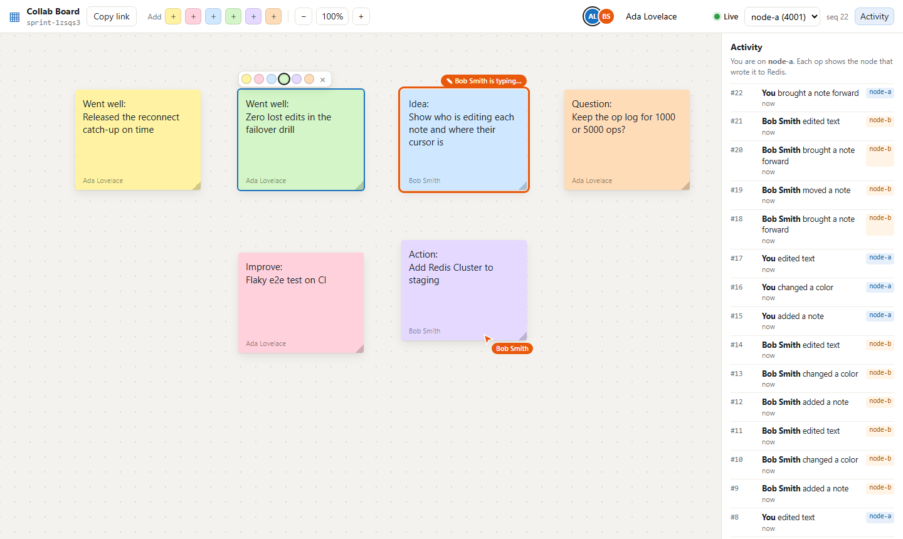
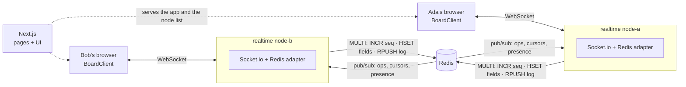

# Realtime Collab Board

A sticky-note board that several people edit at the same time. The UI is Next.js, the live connection is Socket.io, and Redis holds the board and carries messages between servers.

Live collaboration is easy with one server and one process: keep the board in memory and broadcast every change. It breaks as soon as you run two servers, because a user on server A never hears about edits made on server B. Restarts lose the board, and a dropped Wi-Fi connection silently misses changes. In this project the realtime nodes keep no board state. Every change is written to Redis in one atomic transaction that also gives it a sequence number. It then goes to every other node through Redis pub/sub. Clients merge changes field by field, ordered by that number, so everyone ends up with exactly what Redis holds, whatever order messages arrive in. A client that was offline, missed a message, or lost its server catches up from an op log in Redis. While you type in a note, others see your name on it and can't type over you.



*Ada's window, connected to node-a. Bob is connected to node-b: his cursor, the "Bob Smith is typing…" badge on the note he's editing, and the note he moved all reached Ada through Redis pub/sub. The activity feed shows each change's sequence number and the node that wrote it. The screenshot comes from a real run: [scripts/make_screenshot.py](scripts/make_screenshot.py) drives both windows through the UI and checks that they end up with the same notes. [Bob's window](docs/screenshot-bob.png) shows the same board from node-b.*

## How it works



1. Bob drags a note. While he drags, his node broadcasts throttled, unstored `drag` previews so others see the note move. When he lets go, the client sends one `update` op: `{ type, id, opId, fields: { x, y } }`.
2. node-b validates it, then runs a single `MULTI/EXEC`: `INCR seq`, `HSET` the changed fields, and `RPUSH` the op to the board's log. The reply carries the op's seq.
3. node-b acks Bob with the seq and emits the op to the board's room. The [Socket.io Redis adapter](https://github.com/socketio/socket.io-redis-adapter) publishes it, and node-a delivers it to Ada.
4. Ada's client applies it if it's newer than what she has for those fields.

### Why every field converges

Each note field (`x`, `y`, `text`, `color`, ...) is a last-writer-wins register, versioned by the seq of the op that last wrote it. Redis runs a transaction with nothing interleaved, so **seq order is exactly the order in which Redis wrote the fields**. A client that keeps the highest-seq value for each field holds what Redis holds. That stays true when ops arrive late, twice, or out of order, which happens: ops from different nodes come over separate pub/sub publishers. The test `seq order matches write order under concurrent writers` races 200 updates to one field from four connections and checks that Redis and a client agree. A property test applies random op histories in shuffled orders, with duplicates, and checks that every replica matches a model of Redis.

Other details:

- **Deletes are tombstones.** `deleted=1` absorbs any write to the note, including an update that passed its existence check just before the delete committed. An update that arrives before its note's create is kept but hidden until the create arrives. Dropping it would lose the update.
- **No Lua.** The transaction only uses `INCR`, `HSET`, `SADD`/`SREM` and `RPUSH`, so it runs on any Redis, on managed services that restrict scripting, and on the bundled dev server.
- **Redis Cluster ready.** A board's keys share the hash tag `rb:{boardId}:…`, so they live in one slot and the transaction stays valid.
- **Snapshots are atomic.** `MULTI { GET seq; HGETALL fields }` returns a state that includes every op up to that seq and none after it.

### Ordering, retries and exactly-once

- **One op in flight per client.** The client sends its outbox one op at a time, and the server also processes each socket's requests in order. A user's own changes reach Redis in the order they made them. Unsent updates to the same note are merged, so a fast typist or a burst of edits doesn't turn into a burst of writes.
- **Optimistic UI.** Local ops are drawn immediately as overlays on the confirmed state. A remote op on the same field updates the confirmed state underneath, so nothing flickers back before your op is acked.
- **Retries never double-apply.** Every op has a client-generated `opId`. The server claims it with `SET NX` and writes a `committed` marker *inside the same transaction* as the change. A retry after a lost reply, a timeout or a reconnect gets the original result back (or "committed, seq unknown", after which the client reads it from the log) instead of applying the op twice.

### Catching up

The board's op log is a Redis list. The invariant `seq == base + LLEN(log)` holds because the log entry and the seq increment are in the same transaction, and trimming (`LTRIM` + `INCRBY base`) is a single transaction under a lease. Entry *i* therefore has seq `base + i + 1`, with no seq stored in it.

- **Reconnecting** clients join with the last seq they have. They get just the ops they missed, or a snapshot if they're more than 500 behind or the ops were trimmed (the log keeps 1,000).
- **Gaps.** Clients track which seqs they have. A seq that is missing for 1.5 s triggers a catch-up. That covers pub/sub messages lost while a node's subscriber was disconnected, because Redis pub/sub doesn't buffer.
- **Resync hints.** When a node's subscriber reconnects, it tells its clients to catch up immediately. Otherwise a client that receives no further ops would never notice the gap.
- **Joining** puts the socket in the room *before* reading the board, so an op is either in the snapshot or delivered live, never neither.

### Presence, cursors and edit leases

- **Cursors and drag previews** are ephemeral: throttled to about 25 per second on the client, rate-limited on the server, sent as `volatile` (dropped rather than buffered for slow sockets) and never stored.
- **Presence** is a Redis hash per board. Each node refreshes its own sockets every 10 s. Members of a node that crashed stop being refreshed, and after 30 s whichever node looks next removes them and tells the room.
- **Edit leases.** Double-clicking a note takes a 10 s lease (`SET NX PX`) that the editor renews every few seconds. Others see "Bob is typing…", can't open the note, and the server refuses their text edits (`LOCKED`). Moving and recoloring stay allowed. The lease is released on blur or disconnect, and simply expires if the node crashes. Leases are advisory UX: convergence never depends on them.

### Failure behaviour

| What fails | What happens |
| --- | --- |
| A client's connection drops | Edits stay in the outbox and on screen (marked "saving…"). On reconnect the client joins with its last seq, gets the missed ops, then sends the outbox. |
| A realtime node dies | Its clients retry, then fail over to the next node in `REALTIME_URLS` and carry on. Its leases expire and its presence entries are swept. |
| Redis goes down | Writes fail fast (no offline queue on the server) with a retryable error. Clients keep them, show "Saving paused", and retry with backoff. `/health` returns 503. When Redis is back, the outbox drains and lost pub/sub messages are recovered from the log. |
| A node's pub/sub subscriber blips | Messages published meanwhile are lost. A resync hint and gap detection fill them in from the log. |
| A client floods | Ops are rate-limited per socket (`RATE_LIMITED` with `retryAfterMs`, and the client waits). More than 100 queued requests disconnects the socket. |

Each row has an integration test in [test/realtime.test.js](test/realtime.test.js).

## Tech stack

- **Next.js 16** (App Router) + **React 19**, TypeScript. Server components read the node list at request time. The board is one client component on `useSyncExternalStore`.
- **Socket.io 4.8** (WebSocket transport only) with **@socket.io/redis-adapter** for cross-node broadcasts.
- **Redis** via **ioredis 5**: board state (hash + set + list), sequence numbers, op log, leases, presence, and adapter pub/sub.
- Node.js 22 (ES modules, no build step for the server), pino logs.
- Shared plain-JS modules ([shared/](shared/)) used by both the browser and the tests: protocol validation, the merge logic ([board-state.js](shared/board-state.js)) and the client ([board-client.js](shared/board-client.js)).
- [devtools/mini-redis.js](devtools/mini-redis.js): a small RESP2 server (strings, hashes, sets, lists, MULTI, pub/sub with patterns, `PUBSUB NUMSUB`), so the app and tests run without installing Redis.
- `node:test`, Playwright (screenshot script), Docker Compose, GitHub Actions.

## Run it

### Docker

```bash
cp .env.example .env    # optional
docker compose up --build
```

This starts Redis 8 (with AOF persistence), realtime **node-a** on :4001, **node-b** on :4002, and the web app on http://localhost:3000. Click **Create a board**, then open the same board URL in a second window. Each window picks a node at random. Add `?node=0` or `?node=1` to choose one; the node menu in the header switches live. Stop a node (`docker compose stop realtime-a`) and watch its windows move to the other one without losing edits.

### Without Docker

```bash
npm install
npm run dev
```

This starts the bundled mini-redis, both realtime nodes and `next dev` on :3000. Set `REDIS_URL` to use a real Redis. To serve the production build instead: `npm run build && npm run dev -- --prod`.

To run just one realtime node: `REDIS_URL=redis://… PORT=4001 NODE_NAME=node-a npm run start:realtime`. Its health check is `GET /health`.

### Configuration

| Variable | Used by | Default |
| --- | --- | --- |
| `REDIS_URL` | realtime | `redis://127.0.0.1:6379` (`npm run dev` starts mini-redis if unset) |
| `PORT`, `HOST`, `NODE_NAME` | realtime | `4001`, `0.0.0.0`, `<hostname>:<port>` |
| `CORS_ORIGINS` | realtime | `http://localhost:3000` |
| `REALTIME_URLS` | web | `http://localhost:4001,http://localhost:4002` (as the browser reaches them) |
| `LOG_LEVEL` | realtime | `info` |

## Tests

```bash
npm test                                    # 53 tests, about 10 s, against mini-redis
TEST_REDIS_URL=redis://127.0.0.1:6379 npm test   # the same against a real Redis
npm run typecheck
python scripts/make_screenshot.py           # with `npm run dev` running: two-window browser check
```

- [board-state.test.js](test/board-state.test.js): last-writer-wins in any order, tombstones, gaps, snapshot merging, overlays, and a seeded property test (40 random histories × 4 shuffled replicas with duplicates).
- [store.test.js](test/store.test.js): the Redis layer. Ordering under 4 racing connections, dedupe (including a lost reply after commit), rejections, log trimming and the `seq == base + LLEN` invariant, catch-up ranges, leases, presence, behaviour while Redis is down.
- [realtime.test.js](test/realtime.test.js): two real nodes over the Redis adapter, driven by the same `BoardClient` the UI uses. Covers cross-node propagation, presence, cursors, drag previews, and 6 clients making about 360 random concurrent edits that must converge to what a fresh client loads from Redis. Also leases, crash expiry, catch-up from the log versus a snapshot, failover with queued edits, Redis outage and recovery, lost pub/sub messages, rate limiting, input validation and health.
- [mini-redis.test.js](test/mini-redis.test.js): the dev Redis matches Redis semantics for the commands used (list index rules, `WRONGTYPE`, pattern messages, `PUBSUB NUMSUB`, restart keeps data).

CI runs the suite twice, against mini-redis and against a `redis:8-alpine` service, then typechecks, builds, and builds both Docker images.

## Project layout

```
app/                 Next.js routes: landing page, /b/[boardId]
components/          BoardApp (canvas, header, activity), StickyNote
lib/                 useBoard hook, identity, view types
shared/              protocol.js, board-state.js, board-client.js (browser + tests)
server/              realtime node: realtime.js (Socket.io), store.js (Redis), redis.js, rate-limit.js
devtools/            mini-redis.js
scripts/             dev.mjs (whole stack locally), make_screenshot.py
test/                node:test suites
```

## Limitations

- **Never run against a real Redis here.** The development machine had no Redis and no Docker, so the tests, the dev stack and the screenshot all used the bundled mini-redis. It speaks the real protocol to the real ioredis and Socket.io adapter code, but it is a reimplementation. The CI job against `redis:8-alpine`, `docker compose up`, and the Docker builds are written but haven't been run yet.
- **Text is last-writer-wins per note, not merged.** The edit lease stops two people typing into one note, but if a lease lapses (say an editor is offline for over 10 s while someone else takes the note), the later save replaces the whole text. Character-level merging would need a CRDT such as Yjs for the text field.
- **No accounts or access control.** Anyone with a board link can edit it (like an unlisted link). Display names are self-chosen and stored in the browser. Real use needs auth checked in the Socket.io handshake and per-board permissions.
- **Releasing a lease is GET-then-DEL**, not an atomic compare-and-delete. In a rare race it can delete a lease that expired a moment earlier and was re-taken; the new holder's next renewal takes it back. That is acceptable because leases are advisory. A Lua compare-and-delete script would close the gap, at the cost of the no-scripting property above.
- **Tombstones are never collected.** A deleted note leaves one hash field behind. Boards hold at most 300 live notes; there's no limit on deleted ones.
- **No undo, no board list, no history view**, even though the op log would support them.
- **WebSocket only.** Long-polling is turned off because, with several nodes behind a load balancer, it needs sticky sessions. Networks that block WebSockets can't connect.
- Clients get node URLs from `REALTIME_URLS` and fail over in order. In production you would put the nodes behind one load-balanced hostname instead (no sticky sessions needed, since the transport is WebSocket only).


## sort entries

Updated implementation details.


## invalidate cache

Updated implementation details.


## hash password

Updated implementation details.
